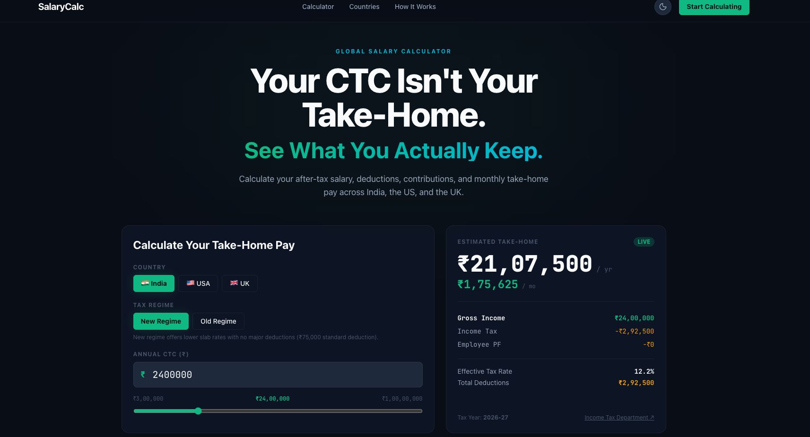

# SalaryCalc

SalaryCalc is a responsive salary and tax estimation application that helps users compare gross pay with take-home pay across India, the United States, and the United Kingdom.

It combines a clean Next.js interface with a modular tax engine, country-specific tax datasets, live calculations, charts, dark/light themes, and a real-time visitor indicator.

**Live demo:** https://salary-calc-v28l.onrender.com/



## Highlights

- Calculate annual and monthly take-home pay
- Compare India New and Old tax regimes
- Enter salary, variable pay/bonus, and additional payroll deductions
- View income tax, social contributions, employee contributions, and total deductions
- Switch between monthly and biweekly take-home views
- Explore country tax information and historical income and tax charts
- Use a responsive dark/light interface across desktop and mobile
- Show an anonymous live visitor count with WebSockets

## Supported jurisdictions

| Country | Tax year | Tax model | Official source |
| --- | --- | --- | --- |
| India | 2026-27 | New/Old regime, progressive income tax, rebate, cess | [Income Tax Department](https://incometaxindia.gov.in) |
| United States | 2026 | Federal progressive tax brackets and simplified FICA | [IRS](https://irs.gov) |
| United Kingdom | 2026-27 | Personal Allowance, progressive income tax, and National Insurance | [HMRC](https://gov.uk/income-tax) |

The application is designed for planning and informational use. Actual payroll results may differ due to employer policies, filing status, benefits, exemptions, state/local taxes, allowances, and other jurisdiction-specific rules.

## Screenshots

### Global salary dashboard


### Country trends


## Tech stack

- **Framework:** Next.js 16 App Router
- **UI:** React 19 and TypeScript
- **Styling:** Tailwind CSS 4
- **Charts:** Recharts
- **Real-time:** Socket.IO and Socket.IO Client
- **Icons:** Lucide React
- **Linting:** ESLint 9

## Getting started

### Prerequisites

- Node.js 20 or newer
- npm

### Installation

```bash
git clone https://github.com/sazua666/Salary_Calc.git
cd Salary_Calc
npm install
```

### Run locally

The custom server starts Next.js and the Socket.IO live-visitor endpoint together.

```bash
npm run dev
```

Open http://localhost:3000.

### Production build

```bash
npm run build
npm start
```

The production server uses `PORT` when supplied:

```bash
PORT=8080 npm start
```

## Available scripts

| Command | Description |
| --- | --- |
| `npm run dev` | Start the development server with Next.js and Socket.IO |
| `npm run build` | Create an optimized production build |
| `npm start` | Run the production server |
| `npm run lint` | Run ESLint |

## How calculations work

The tax engine lives in `src/tax/engine/calculateSalary.ts`. It:

1. Reads the selected country and tax-year dataset.
2. Applies progressive tax brackets to taxable income.
3. Adds applicable rebates or cess for the selected tax regime.
4. Calculates country-specific social contributions or payroll deductions.
5. Subtracts deductions from gross income to produce annual and monthly take-home estimates.

Tax rules are stored as versioned datasets in `src/tax/datasets/` and carry source metadata such as the official source, effective date, review date, and rules version.

### India

- Supports New and Old regimes
- Applies standard deductions
- Calculates the Section 87A rebate and 4% Health & Education Cess
- Includes annual employee PF when supplied through components

### United States

- Uses IRS federal progressive brackets
- Applies a standard deduction of `$15,000` for the current federal model
- Estimates FICA at `7.65%`
- Federal and FICA estimates are provided only; state and local taxes are not included

### United Kingdom

- Applies the £12,570 Personal Allowance
- Uses progressive income-tax bands
- Estimates employee National Insurance using the simplified thresholds in the 2026-27 dataset

## Project structure

```text
src/
├── app/                         # Next.js routes and metadata
├── components/
│   ├── calculator/              # Salary calculator interfaces
│   ├── charts/                  # Recharts visualizations
│   ├── layout/                  # Navbar, footer, theme, live widgets
│   └── ui/                      # Shared UI components
├── hooks/                       # Browser-side hooks
├── lib/                         # Shared utilities
└── tax/
    ├── datasets/                # Country tax rules for 2026
    └── engine/                  # Tax calculation logic and types
server.mjs                       # Next.js server + Socket.IO endpoint
```

## Live visitor count

The custom server at `server.mjs` maintains a set of active Socket.IO sessions and broadcasts count updates over the `/api/socketio` path.

The browser creates an anonymous session identifier in `sessionStorage`; no salary or personal financial input is sent to the server.

## Privacy

Salary calculations run in the browser and are not sent to a backend. The only server-side real-time feature is the anonymous active-visitor count.

## Disclaimer

SalaryCalc provides estimates for educational and planning purposes. It is not tax, payroll, or financial advice, and the displayed figures should not replace advice from a qualified professional or an official payroll calculation.

## Contributing

1. Fork the repository.
2. Create a focused feature or fix branch.
3. Make changes and run `npm run lint`.
4. Verify the production build with `npm run build`.
5. Open a pull request with the relevant screenshots or test cases.
